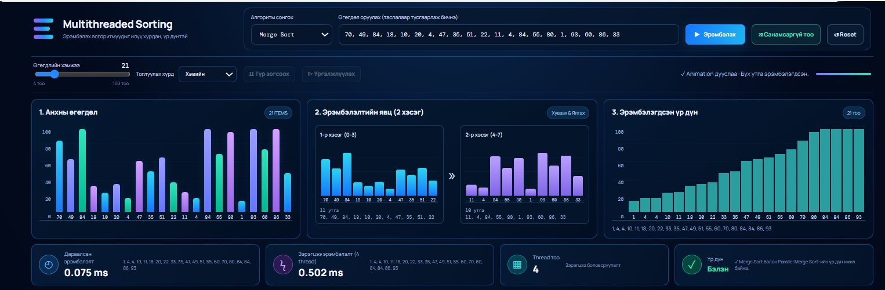

# SortLab — Эрэмбэлэх алгоритмын харьцуулалт ба дүрслэл

**SortLab** нь Python болон Flask ашиглан хөгжүүлсэн эрэмбэлэх алгоритмуудыг дүрслэх, харьцуулах, гүйцэтгэлийг хэмжих вэбэд суурилсан систем юм.

Хэрэглэгч өөрийн өгөгдлийг оруулах эсвэл автоматаар өгөгдөл үүсгэх, эрэмбэлэх алгоритм сонгох, эрэмбэлэх явцыг алхам алхмаар харах, дараалсан болон зэрэгцээ боловсруулалтын хурдыг харьцуулах боломжтой.

## Багийн гишүүд

| № | Овог, нэр | Оюутны код |
|---|---|---|
| 1 | Н.Д. Цогзолдорж | B241940011 |
| 2 | Э. Номинзул | B242270082 |
| 3 | Ж. Ариунсанаа | B241940118 |

## 1. Төслийн танилцуулга

SortLab систем нь эрэмбэлэх алгоритмуудын ажиллагааг ойлгох, тэдгээрийн гүйцэтгэлийг харьцуулах интерактив орчныг бүрдүүлнэ.

Системийн үндсэн зорилго нь:
- Эрэмбэлэх алгоритмуудын ажиллагааг дүрслэн харуулах.
- Өөр өөр алгоритмуудын гүйцэтгэлийг харьцуулах.
- Дараалсан болон зэрэгцээ боловсруулалтын ялгааг харуулах.
- Өгөгдлийн хэмжээнээс хамаарсан гүйцэтгэлийг хэмжих.

### Үндсэн нүүр хуудас


## 2. Системийн боломжууд

- Вэбэд суурилсан интерактив хэрэглэгчийн интерфэйс.
- Найман төрлийн эрэмбэлэх алгоритм.
- Дараалсан болон зэрэгцээ эрэмбэлэлтийн харьцуулалт.
- Эрэмбэлэх үйл явцыг алхам алхмаар дүрслэх.
- Эрэмбэлэлтийн явцыг бодит хугацаанд дамжуулах.
- Алгоритмуудын гүйцэтгэлийг хэмжих, харьцуулах.
- Хэрэглэгч өөрийн өгөгдлийг оруулах боломж.
- Автоматаар өгөгдөл үүсгэх боломж.

## 3. Ашигласан эрэмбэлэх алгоритмууд

Төсөлд дараах найман төрлийн эрэмбэлэх алгоритмыг хэрэгжүүлсэн.

| № | Алгоритмын нэр | Дундаж хугацааны нийлмэл чанар |
|---|---|---|
| 1 | Merge Sort | O(n log n) |
| 2 | Bubble Sort | O(n²) |
| 3 | Insertion Sort | O(n²) |
| 4 | Selection Sort | O(n²) |
| 5 | Quick Sort | O(n log n) |
| 6 | Heap Sort | O(n log n) |
| 7 | Shell Sort | Алхамын дарааллаас хамаарна |
| 8 | Counting Sort | O(n + k) |

### Эрэмбэлэх үйл явцын дүрслэл

Хэрэглэгч эрэмбэлэх алгоритмын ажиллах явцыг дэлгэц дээр алхам алхмаар харах боломжтой.


## 4. Дараалсан болон зэрэгцээ эрэмбэлэлт

SortLab систем нь дараалсан Merge Sort болон зэрэгцээ Parallel Merge Sort алгоритмуудыг харьцуулдаг.

**Дараалсан эрэмбэлэлт (Sequential Sorting):**
- Өгөгдлийг нэг дарааллаар боловсруулна.
- Эрэмбэлэх үйлдлүүдийг дарааллын дагуу гүйцэтгэнэ.

**Зэрэгцээ эрэмбэлэлт (Parallel Sorting):**
- Өгөгдлийг хэд хэдэн хэсэгт хуваана.
- Олон thread ашиглан хэсгүүдийг зэрэг боловсруулна.
- Үүссэн эрэмбэлэгдсэн хэсгүүдийг нэгтгэнэ.

### Дараалсан ба зэрэгцээ эрэмбэлэлтийн харьцуулалт



## 5. Гүйцэтгэлийн хэмжилт (Performance Benchmark)

Benchmark хэсэг нь эрэмбэлэх алгоритмуудын ажиллах хугацааг хэмжиж, хооронд нь харьцуулна.

Үндсэн боломжууд:
- Хэрэглэгчийн оруулсан өгөгдөл дээр хэмжилт хийх.
- Өөр өөр хэмжээтэй өгөгдөл автоматаар үүсгэх.
- Хэмжилтийг 1–5 удаа давтах.
- Давталтуудын медиан хугацааг тооцоолох.
- Эрэмбэлэлтийн үр дүн зөв эсэхийг шалгах.

Автоматаар үүсгэх өгөгдлийн хэмжээ:
- 100 элемент
- 250 элемент
- 500 элемент
- 1000 элемент

### Benchmark үр дүн


## 6. Ашигласан технологиуд

| Технологи | Ашигласан зориулалт |
|---|---|
| Python | Backend болон алгоритмын логик |
| Flask | Вэб системийн framework |
| HTML | Вэб хуудасны бүтэц |
| CSS | Хэрэглэгчийн интерфэйсийн загвар |
| JavaScript | Frontend үйлдэл болон дүрслэл |
| Threading | Зэрэгцээ боловсруулалт |
| Queue | Thread хооронд мэдээлэл дамжуулах |

## 7. Төслийн бүтэц

```text
F.CSM302-TeamProject-4-2-6/
│
├── app.py
├── requirements.txt
├── README.md
│
├── src/
│   └── sorting/
│       ├── merge_sort.py
│       ├── bubble_sort.py
│       ├── insertion_sort.py
│       ├── selection_sort.py
│       ├── quick_sort.py
│       ├── heap_sort.py
│       ├── shell_sort.py
│       ├── counting_sort.py
│       ├── parallel_sort.py
│       └── benchmark.py
│
├── templates/
│   └── index.html
│
├── static/
│   ├── css/
│   │   └── style.css
│   └── js/
│       └── app.js
│
└── screenshots/
    ├── main-dashboard.png
    ├── sorting-visualization.png
    ├── parallel-comparison.png
    └── benchmark-results.png
```

## 8. Суулгах болон ажиллуулах заавар

### 1. Repository-г татах

```bash
git clone https://github.com/Zulaa112201/F.CSM302-TeamProject-4-2-6.git
```

### 2. Төслийн хавтас руу орох

```bash
cd F.CSM302-TeamProject-4-2-6
```

### 3. Шаардлагатай сангуудыг суулгах

```bash
pip install -r requirements.txt
```

### 4. Програмыг ажиллуулах

```bash
python app.py
```

### 5. Вэб хөтөчөөр нээх

Дараах хаягаар орно:

```text
http://127.0.0.1:5000
```

## 9. API замууд (API Endpoints)

| HTTP арга | API зам | Тайлбар |
|---|---|---|
| GET | `/` | Системийн үндсэн хуудсыг харуулах |
| POST | `/api/sort` | Дараалсан болон зэрэгцээ эрэмбэлэлт хийх |
| POST | `/api/sort/stream` | Эрэмбэлэх үйл явцыг алхам алхмаар дамжуулах |
| GET/POST | `/api/benchmark` | Гүйцэтгэлийн хэмжилт хийх |

## 10. Өгөгдлийн шалгалт

Систем нь хэрэглэгчийн оруулсан өгөгдлийг шалгаж, буруу утгаас үүсэх алдаанаас сэргийлнэ.

- Оруулах бүхэл тооны тоо 4–5000 байна.
- Тоон утгууд JavaScript-ийн аюулгүй бүхэл тооны хязгаарт багтсан байна.
- Эрэмбэлэлтийн үр дүнг зөв эсэхийг шалгана.

## 11. Дүгнэлт

Энэхүү төслийн хүрээнд найман төрлийн эрэмбэлэх алгоритмыг нэг системд нэгтгэн, тэдгээрийн ажиллагаа болон гүйцэтгэлийг харьцуулах боломжтой вэб програм боловсруулсан.

Мөн дараалсан болон зэрэгцээ боловсруулалтыг харьцуулснаар олон thread ашиглахын онцлог, гүйцэтгэлд үзүүлэх нөлөөг судлах боломж бүрдсэн.

SortLab нь эрэмбэлэх алгоритмуудыг ойлгох, турших, гүйцэтгэлийг харьцуулахад зориулагдсан интерактив систем юм.